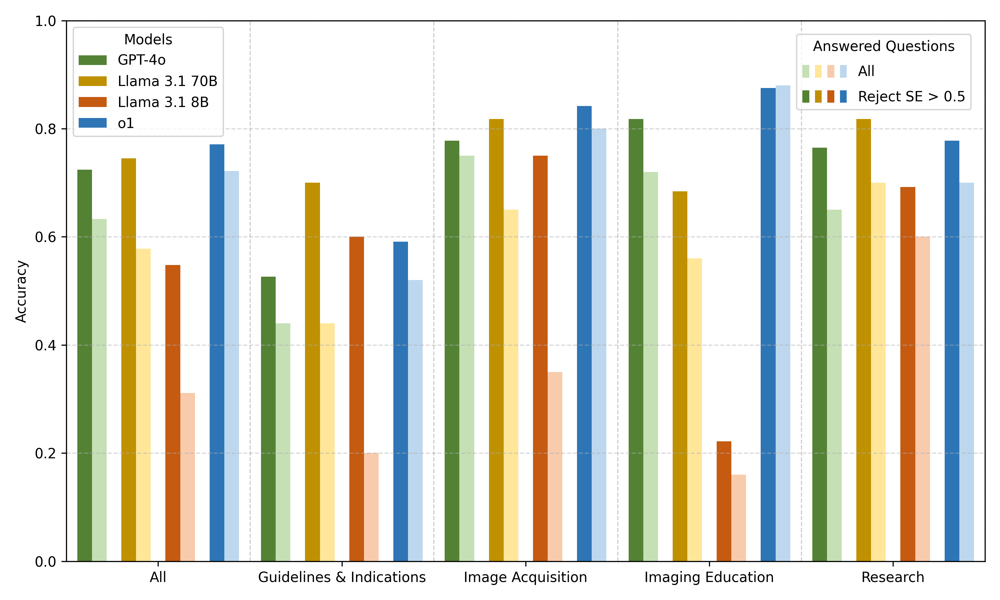
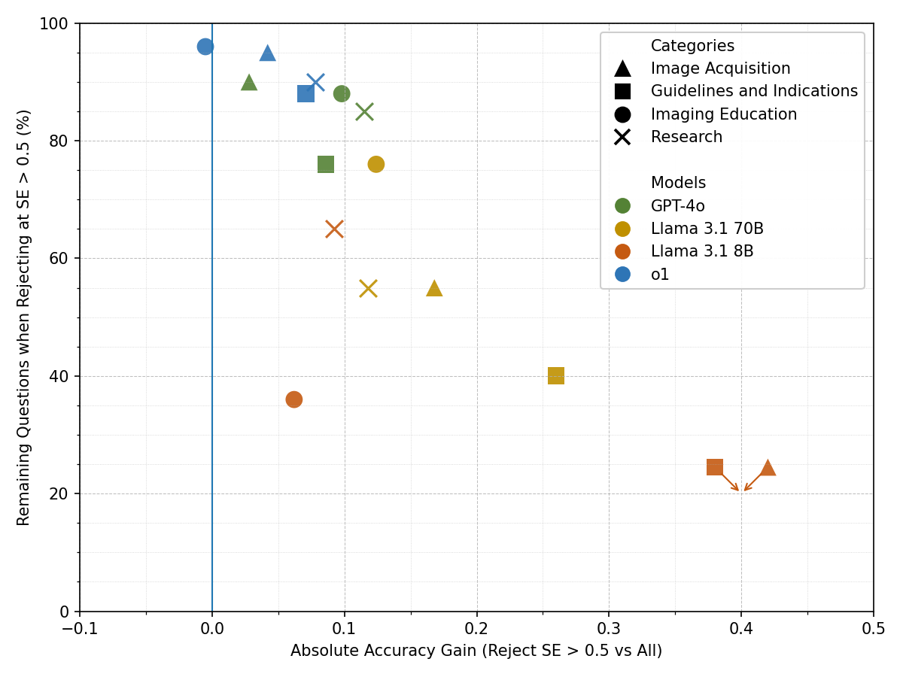

# Entropy-based Rejection of Radiology-related Questions: A Comparative Analysis of the Accuracy of Large Language Models

[](https://python.org)
<!--TODO: Add [](LICENSE) -->

## Overview

Large language models (LLMs) may assist radiologists, but hallucinations limit their clinical use. This repository contains the code and data for our study evaluating whether discrete semantic entropy, a measure of the variability in meaning across multiple answers to the same question [[1]](https://doi.org/10.1038/s41586-024-07421-0), can identify radiology questions that are likely to be answered incorrectly, and whether rejecting these questions improves answer accuracy.

We evaluated four LLMs (GPT-4o, o1, Llama 3.1 70B, and Llama 3.1 8B) on 90 expert-curated radiology questions from four categories. For each question, 10 answers were sampled at temperature 1.0, clustered by bidirectional entailment, and used to compute semantic entropy (SE); a separate low-temperature answer (0.1) was used to measure accuracy.

<!--TODO: Add link to the paper -->

### Key Findings

- o1 achieved the highest baseline accuracy (72%); rejecting questions with SE > 0.5 increased its accuracy to 77% (+5 percentage points) while discarding only 8% of questions
- Accuracy improved for all models after entropy-based rejection: GPT-4o +9, Llama 3.1 70B +17, and Llama 3.1 8B +24 percentage points, at rejection rates of 16%, 43%, and 66%
- Rejection rates and gains varied substantially between models and question categories; the largest gains occurred for guidelines and indications questions
- Semantic consistency is not correctness: even at SE ≤ 0.1, up to 25% of the remaining questions were answered incorrectly

---

## Quick Start

### Prerequisites

- **Python**: 3.11.9
- **Conda**: Installed and configured
- **Note**: We used Ubuntu 22.04

### Installation

1. **Clone the repository**

2. **Set up the conda environment**
   ```
   $ conda env create --name semantic_entropy_radiology --file=environment.yml
   ```

3. **Activate the environment**
   ```
   $ conda activate semantic_entropy_radiology
   ```

---

## Dataset

The 90 questions were designed by a board-certified radiologist and reviewed by a second board-certified radiologist. Each question comes with a reference answer and its source. The questions are stored as semicolon-separated CSV files in the [`questions`](questions/) folder:

| Category | Questions | File |
|:---------|:---------:|:-----|
| Guidelines and indications | 25 | [`Questions_Semantic_Entropy_Guidelines_and_Indications.csv`](questions/Questions_Semantic_Entropy_Guidelines_and_Indications.csv) |
| Image acquisition | 20 | [`Questions_Semantic_Entropy_Image_Acquisition.csv`](questions/Questions_Semantic_Entropy_Image_Acquisition.csv) |
| Imaging education | 25 | [`Questions_Semantic_Entropy_Imaging_Education.csv`](questions/Questions_Semantic_Entropy_Imaging_Education.csv) |
| Research | 20 | [`Questions_Semantic_Entropy_Research.csv`](questions/Questions_Semantic_Entropy_Research.csv) |

Columns: `Topic` (question number), `Question`, `Correct Answer`, `Subtopic`, `Reference`, `Latest update`, `Link`.

---

## Quick Evaluation

All LLM responses and entailment/correctness judgments of our study are cached in the [`cache`](cache/) folder. To reproduce the results of the paper from the cache (no API access required), run:

```
$ python3 eval.py
```

This prints, for each model and category (and for the short- and long-answer subsets), the baseline accuracy, AUROC, AURAC, the rejection accuracies, and the accuracy and number of remaining questions for semantic entropy thresholds from 0.0 to 1.0. It also prints the bootstrapped accuracy gains at SE ≤ 0.5 (10<sup>6</sup> resamples, Bonferroni-adjusted 98.75% confidence intervals).

To reproduce the sensitivity analysis with gpt-oss-120b as alternative entailment model (semantic clustering of the same answers), run:

```
$ python3 eval_GPT_OSS_120B.py
```

> **Note**: The correctness labels in [`cache/entailmentCacheFile_GPT4o.csv`](cache/entailmentCacheFile_GPT4o.csv) were initially assessed by GPT-4o and then manually reviewed and corrected where necessary by a board-certified radiologist. The reported results are based on these radiologist-reviewed labels.

---

## Reproducing the Results from Scratch

> **Note**: Due to the non-deterministic nature of LLMs, new prompting may yield slightly different results.

1. **Configure credentials** in [`CONFIG.py`](CONFIG.py):
   - `OPENAI_KEY` and `AZURE_ENDPOINT` for GPT-4o and o1-preview (Microsoft Azure OpenAI API, deployments `gpt-4o` and `o1-preview`)
   - `LOCAL_KEY` and `LOCAL_ENDPOINT` for an OpenAI-compatible server hosting `openai/gpt-oss-120b` (only needed for the short/long split and the gpt-oss-120b entailment analysis)
   - Llama 3.1 is run locally via [Ollama](https://ollama.com) (`llama3.1:8b` and `llama3.1:70b`, 4-bit quantized)

2. **Clear the [`cache`](cache/) directory** to ensure a clean evaluation.

3. **Generate the answers** (11 answers per question and model; ID `0` at temperature 0.1 for the accuracy, IDs `1`–`10` at temperature 1.0 for the semantic entropy):
   ```
   $ python3 generateAnswers.py
   ```
   Results are saved in the `cache` directory with filenames prefixed with `EVAL`.

4. **Split into short- and long-answer questions** (classification of each question–reference answer pair by gpt-oss-120b):
   ```
   $ python3 splitQuestions.py
   ```

5. **Run the evaluation**:
   ```
   $ python3 eval.py
   $ python3 eval_GPT_OSS_120B.py
   ```
   GPT-4o (or gpt-oss-120b) is used for the bidirectional entailment checks of the semantic clustering and for the comparison of the final answer with the reference answer. All judgments are cached in `cache/entailmentCacheFile_*.csv`.

---

## Figure Generation

| Figure | Script | Output |
|:-------|:-------|:-------|
| Figure 3 (accuracy before and after rejection) | [`newFigure/genFig3.py`](newFigure/genFig3.py) | `Figure3v2.png` |
| Figure 5 (accuracy gain vs. remaining questions) | [`newFigure/genFig4.py`](newFigure/genFig4.py) | `ent05_vs_ent10_scatter_final.png` |
| Supplementary Figure 1 (short vs. long answers) | [`newFigure/createFigureSup1.py`](newFigure/createFigureSup1.py) | `FigureSup1_SE.png` |
| Supplementary Figure 2 (mean token probability baseline) | [`logProbBasedRejection.py`](logProbBasedRejection.py) | `newFigure/FigureLogProb_ThresholdProb.png` |
| Supplementary Figure 3 (gpt-oss-120b as entailment model) | [`newFigure/createFigGPT-ossGPT4o.py`](newFigure/createFigGPT-ossGPT4o.py) | `FigGPT-ossGPT4o.png` |

The scripts in `newFigure` contain the values from the evaluation output and are run from within that folder (e.g. `cd newFigure && python3 genFig3.py`). [`logProbBasedRejection.py`](logProbBasedRejection.py) reads the cached GPT-4o answers and is run from the repository root.

---

## Results

### Accuracy Before and After Entropy-based Rejection



**Figure 3**: Accuracies when all questions with SE > 0.5 are rejected (darker bars) and baseline accuracies (lighter bars) for each model, across all categories and per category.

**Table 1**: Results across all categories (SE threshold 0.5). Accuracy gains with 98.75% bootstrap confidence intervals.

| Model | Baseline Accuracy | Accuracy (SE ≤ 0.5) | Gain [98.75% CI] (pp) | Remaining Questions | AUROC | AURAC |
|:------|:-----------------:|:-------------------:|:---------------------:|:-------------------:|:-----:|:-----:|
| o1 | **0.72** | **0.77** | +5 [0.5; 10.8] | **92%** | 0.66 | **0.84** |
| GPT-4o | 0.63 | 0.72 | +9 [2.8; 16.7] | 84% | 0.70 | 0.79 |
| Llama 3.1 70B | 0.58 | 0.75 | +17 [5.5; 29.3] | 57% | **0.79** | 0.78 |
| Llama 3.1 8B | 0.31 | 0.55 | **+24** [6.6; 42.5] | 34% | 0.73 | 0.48 |

### Accuracy Gain vs. Rejected Questions



**Figure 5**: Absolute accuracy gain at SE > 0.5 rejection and the corresponding percentage of remaining questions; each point is one model and question category.

---

## Project Components

### Configuration
- [`CONFIG.py`](CONFIG.py): Credentials, cache paths, sampling temperatures, number of samples per question, and prompt prefixes.

### Dataset
- [`RadDataset.py`](RadDataset.py): Loads the question CSV files.

### Answer Generation
- [`generateAnswers.py`](generateAnswers.py): Queries each LLM for each question and stores the answers in `cache/EVAL_*.csv`.
- [`promptLLM.py`](promptLLM.py): Prompt functions for GPT-4o, o1-preview, Llama 3.1 8B/70B and gpt-oss-120b; all prompts and responses are logged.

### Semantic Entropy and Evaluation
- [`EntailmentCheck.py`](EntailmentCheck.py): Bidirectional entailment check for the semantic clustering and correctness check of the final answer, with caching of all judgments.
- [`clusterAnswers.py`](clusterAnswers.py): Semantic clustering, discrete semantic entropy, accuracy, AUROC, AURAC, entropy-based rejection, and bootstrapping.
- [`eval.py`](eval.py): Main evaluation (GPT-4o as entailment model), including the short-/long-answer analysis.
- [`eval_GPT_OSS_120B.py`](eval_GPT_OSS_120B.py): Evaluation with gpt-oss-120b as alternative entailment model.
- [`splitQuestions.py`](splitQuestions.py): Splits the questions into short- and long-answer items (`cache/SHORT_EVAL_*.csv`, `cache/LONG_EVAL_*.csv`).
- [`logProbBasedRejection.py`](logProbBasedRejection.py): Token-level confidence baseline (mean token probability of the GPT-4o answers).
- [`utilFunctions.py`](utilFunctions.py): CSV helper functions.

---

## Citation

If you use this code or dataset in your research, please cite our work:

```bibtex
@article{wienholt_entropy_rejection_radiology,
  title={Entropy-based Rejection of Radiology-related Questions: A Comparative Analysis of the Accuracy of Large Language Models},
  author={Wienholt, Patrick and von der Stueck, Marc S. and Kuhl, Christiane and Bruners, Philipp and Kather, Jakob Nikolas and Nebelung, Sven and Truhn, Daniel and Siepmann, Robert M.},
  note={Under review}
}
```

## References

[1] Farquhar, S., Kossen, J., Kuhn, L. et al. Detecting hallucinations in large language models using semantic entropy. Nature 630, 625–630 (2024). https://doi.org/10.1038/s41586-024-07421-0
